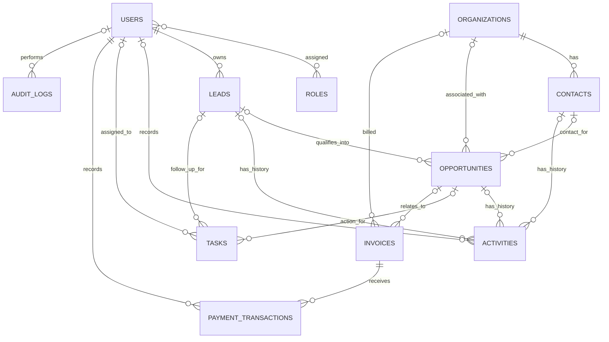

# HRUTA OneCRM — Database Schema Design

This logical design follows the proposal's page 8 entity inventory and prioritizes the Phase 1 Core MVP described on page 10. It is a starter technical design and must be reviewed with HRUTA's process owners before production.

## MVP tables

| Table | Purpose | Important relationships / fields |
|---|---|---|
| `users` | Internal user accounts | Unique email, password hash, active flag, timestamps |
| `roles` | Named access roles | Unique role name |
| `user_roles` | Many-to-many user-role assignment | FK to users and roles; composite primary key |
| `organizations` | Client, college, partner, prospect profiles | Organization type, name, website, industry |
| `contacts` | People at organizations | Optional FK to organizations; contact details |
| `leads` | Business enquiries | Source, interest, priority, status, owner, next follow-up |
| `opportunities` | Qualified sales deals | Optional links to lead, organization, contact; stage and expected value |
| `activities` | Call, email, meeting and note history | Optional links to lead, opportunity, contact; owner and date |
| `tasks` | Internal actions and follow-ups | Assignee, creator, due date, status, optional lead/opportunity links |
| `invoices` | Charges issued to clients | Unique invoice number, amount, due date, optional organization/opportunity |
| `payment_transactions` | Individual payments | FK to invoice, amount, date, method, reference, status, recorded-by user |
| `audit_logs` | Important action history | Actor, action, entity type/id, timestamp, details |

## Relationship diagram

`o|` in the diagram means an optional relationship. The database models and foreign keys in `app/models.py` are the executable implementation of the MVP tables.

## Additional implemented module tables

The SQLAlchemy API also implements these proposal workflows:

- **Sales:** `pipeline_history`, `sales_proposals`.
- **Internships:** `internship_programs`, `internship_applications`, `internship_interviews`, `intern_allocations`, `internship_attendance`, `internship_tasks`, `internship_certificates`.
- **Training coordination:** `courses`, `trainers`, `training_batches`, `training_enrollments`, `training_sessions`, `training_attendance`, `assessments`, `assessment_results`, `learner_feedback`.
- **Partnerships:** `partners`, `partnership_activities`, `partnership_agreements`.
- **Projects:** `projects`, `project_milestones`, `project_updates`, `project_tasks`.
- **Workspace services:** `notifications`, `refunds`, `app_configuration`, `document_references`.

Document file bytes are stored in the private upload directory; `document_references` stores metadata and links files to CRM entities. The API does not implement external LMS/accounting/WhatsApp integrations or AI features.

## Design constraints

1. Keep leads, opportunities, internship applications, training enrolments, invoices and payment transactions as distinct entities.
2. Use foreign keys for referential integrity and stable numeric IDs for this starter.
3. Use `NUMERIC(12,2)` and Python `Decimal` for money.
4. Add indexes for frequently filtered fields (email, owner, status, follow-up and due dates).
5. Use server-side authorization for record-level and role-level permissions.
6. Keep payment records instead of overwriting the payment history; track refunds through request, approval/rejection and processing records.
7. Define data retention, export, deletion, backup and restoration policies with management.
8. For production, generate and review Alembic migrations rather than relying on `Base.metadata.create_all`.
